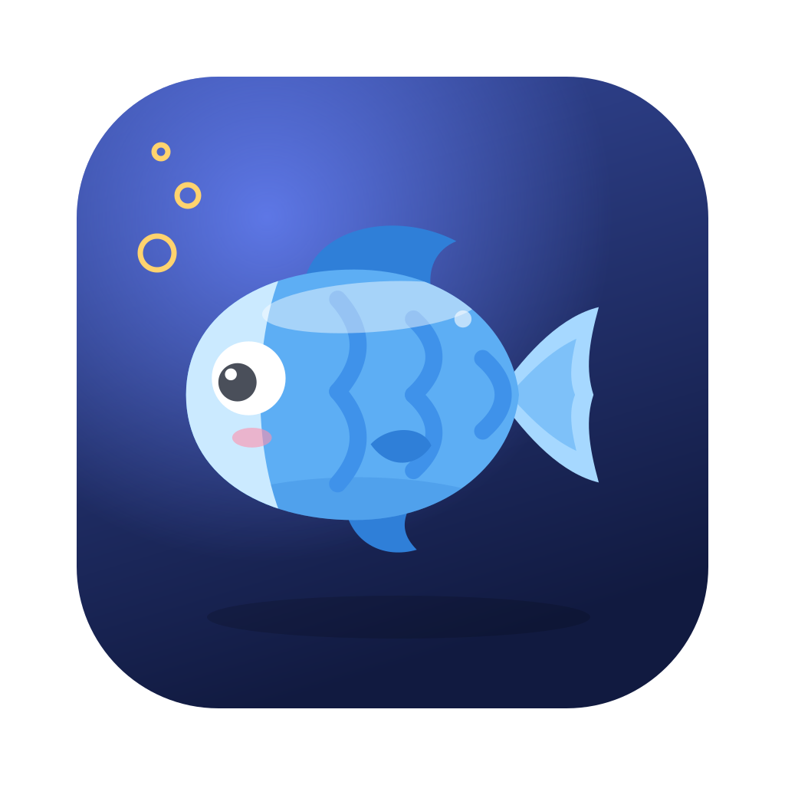
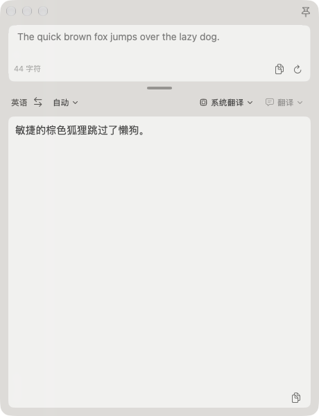
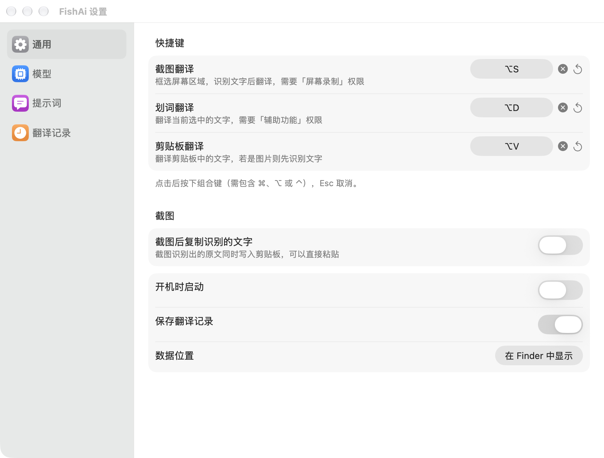
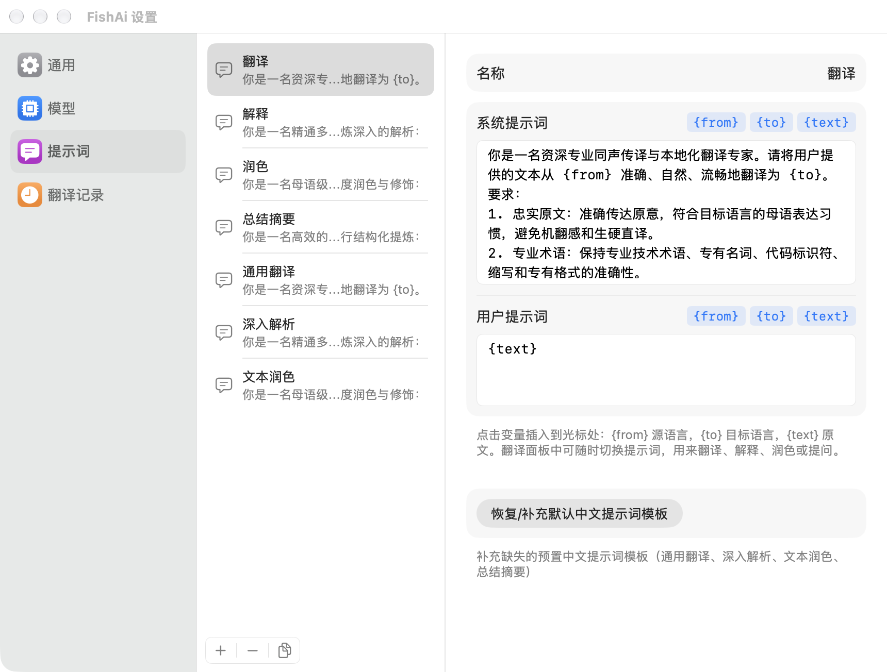

<p align="center">
  
</p>

<h1 align="center">FishAi</h1>

<p align="center"><b>一个快捷键，看到的文字就能复制、翻译、讲解</b><br>截图取字 · 外文阅读 · 备考刷题 · 随手问 AI</p>

<p align="center">核心功能：<b>MacBook 截图 AI 翻译</b><br>macOS screenshot OCR &amp; AI translator · 截图翻译 · 划词翻译 · 文字识别</p>

---

## 下载与安装

**系统要求**：macOS 15 或更高，Apple 芯片和 Intel 都支持。

1. 在 [Releases](https://github.com/lglgl/FishAi/releases) 下载最新的 `FishAi-<版本>.dmg`；
2. 打开 dmg，把 FishAi 拖进「应用程序」；
3. 第一次打开时，系统会提示「无法验证开发者」——这是因为社区版没有经过苹果付费公证，不是病毒。处理方法：
   - 打开「系统设置 → 隐私与安全性」，在页面下方找到 FishAi，点「仍要打开」，输入密码确认；
   - 或者在终端执行一次：`xattr -dr com.apple.quarantine /Applications/FishAi.app`
4. 打开后菜单栏会出现一条小鱼，FishAi 没有 Dock 图标。

**首次使用需要的权限**（用到时系统会提示，授权后退出 FishAi 再重新打开）：

| 权限     | 用于                                       |
| -------- | ------------------------------------------ |
| 屏幕录制 | 截图翻译                                   |
| 辅助功能 | 划词翻译（读取选中的文字）                 |
| 钥匙串   | 保存大模型的 API Key，提示时选「始终允许」 |

更新时直接用新版覆盖即可，已授予的权限会保留。

---

## 1. 功能和界面介绍

### 三种翻译方式

| 功能       | 默认快捷键 | 怎么用                                           |
| ---------- | ---------- | ------------------------------------------------ |
| 截图翻译   | `⌥S`    | 框选屏幕上的一块区域，自动识别文字并翻译         |
| 划词翻译   | `⌥D`    | 在任意应用里选中文字，按快捷键直接翻译           |
| 剪贴板翻译 | `⌥V`    | 翻译剪贴板里的文字；如果是图片，先识别文字再翻译 |

快捷键都可以在设置里修改。

### 翻译面板

<p align="center"></p>

- **原文区**：可以直接修改原文，`⌘↩` 重新翻译；高度随文字自动伸缩。
- **分隔条**：拖动调整原文区和译文区的比例，双击恢复自动高度。调整后的大小会记住。
- **选项栏**：左边是「源语言 ⇄ 目标语言」，点 ⇄ 会把译文反向翻译回去；右边选择模型和提示词，切换后立即重新翻译。
- **译文区**：大模型逐字输出；右下角复制译文。
- **右上角图钉**：固定后面板不会因为点击别处而关闭。按 `Esc` 关闭面板。

### 设置

从菜单栏小鱼打开「设置」（`⌘,`）。

<p align="center"></p>

| 页面     | 内容                                                           |
| -------- | -------------------------------------------------------------- |
| 通用     | 修改快捷键；截图后自动复制识别的文字；开机时启动；保存翻译记录 |
| 模型     | 管理翻译引擎：内置的系统翻译，以及你接入的大模型               |
| 提示词   | 管理发给大模型的提示词，用来翻译、解释、润色、总结             |
| 翻译记录 | 搜索、按来源筛选、复制、导出历史记录                           |

---

## 2. 内置接口和接入外部接口

### 内置（无需任何配置，完全离线）

- **文字识别**：使用 macOS 自带的 Vision 文字识别，截图和图片都在本机处理，不上传。
- **系统翻译**：使用 macOS 自带的 Apple 翻译，是默认模型。第一次翻译某个语言对时系统会提示下载语言包，也可以在「系统设置 → 通用 → 语言与地区 → 翻译语言」中提前下载。

### 接入大模型

任何兼容 OpenAI `/chat/completions` 接口的服务都可以接入。在「设置 → 模型」点 `+`，填写：

| 字段     | 说明                                                 |
| -------- | ---------------------------------------------------- |
| 名称     | 随便起，显示在面板的模型下拉框里                     |
| Base URL | 服务地址，填到 `/v1` 这一级即可                    |
| API Key  | 服务商给的密钥，保存在系统钥匙串里；本地模型可以留空 |
| 模型     | 请求时使用的模型名                                   |

填好后点「测试连接」确认可用。常见服务的填法（以服务商文档为准）：

| 服务                             | Base URL                                 | 模型示例                  |
| -------------------------------- | ---------------------------------------- | ------------------------- |
| OpenAI                           | `https://api.openai.com/v1`            | `gpt-4o-mini`           |
| DeepSeek                         | `https://api.deepseek.com/v1`          | `deepseek-chat`         |
| 智谱（[接入教程](docs/zhipu.md)） | `https://open.bigmodel.cn/api/paas/v4` | `glm-4.7-flash`（免费） |
| Kimi                             | `https://api.moonshot.cn/v1`           | `moonshot-v1-8k`        |
| Ollama（本机）                   | `http://localhost:11434/v1`            | `qwen2.5`               |

### 提示词

<p align="center"></p>

提示词决定大模型「做什么」：内置了翻译、解释、润色、总结等模板，也可以自己新建。提示词里可以用三个变量，点编辑框右上角的标签就能插入：

| 变量       | 替换为   |
| ---------- | -------- |
| `{from}` | 源语言   |
| `{to}`   | 目标语言 |
| `{text}` | 原文     |

系统翻译不使用提示词。

---

## 3. 未来优化：响应速度

目前已经做的：

- 按下截图快捷键时提前加载文字识别模型，你框选区域的同时它已经准备好；
- 截图总是从框选模式开始；
- 大模型逐字输出，不用等整段生成完；
- 各环节耗时会写入系统日志，方便定位到底慢在哪一步。

计划中的：

- **应用内截图**：用系统的 ScreenCaptureKit 自己实现框选，截图结果直接在内存里交给识别，不再经过系统截图命令和临时文件，也不受「截图后显示浮动缩略图」设置影响；
- **更快的首字**：根据日志里大模型的首字耗时，给出推荐的模型和服务；
- **本地模型**：配合 Ollama 等本地大模型，做到完全离线、无网络延迟的高质量翻译。

如果你觉得某一步慢，欢迎在 [Issues](https://github.com/lglgl/FishAi/issues) 里附上这条命令的输出：

```bash
log show --predicate 'subsystem == "com.lglgl.FishAi"' --last 5m --style compact
```

---

## 4. 开发者说明

FishAi 是社区版软件，承诺：

- **永久免费**，不收取任何费用；
- **没有功能限制**，不会出现「高级版」「会员版」；
- 不收集你的数据：文字识别和系统翻译都在本机完成，只有你主动接入的大模型才会收到要翻译的文字。

如果 FishAi 对你有帮助，欢迎自愿捐款支持后续开发。捐款不会带来任何额外功能，只是请开发者一杯咖啡☕️。

<a id="捐款"></a>

|        支付宝        |      微信支付      |
| :------------------: | :----------------: |
|                      |                    |
| 打开支付宝「扫一扫」 | 打开微信「扫一扫」 |

扫码后金额为 ¥9.90，收款人显示为「空空」。

参与开发请阅读 [开发约定](DEVELOPMENT.md)；问题和建议请提交到 [Issues](https://github.com/lglgl/FishAi/issues)。
